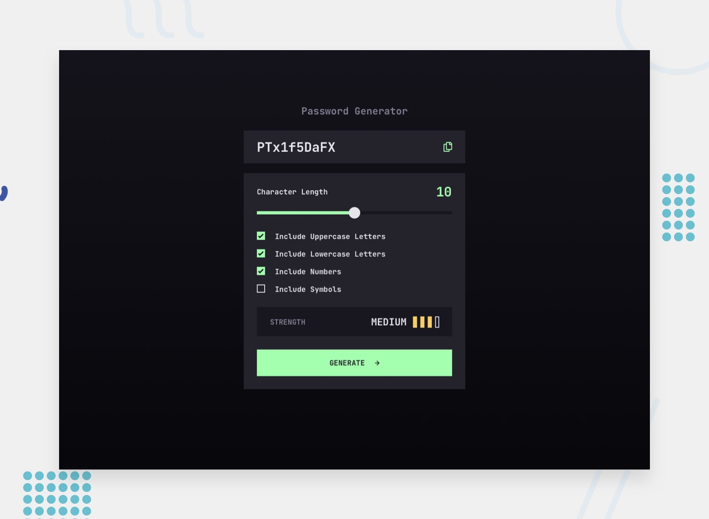

# Frontend Mentor – Password generator app solution

This is a solution to the [Password generator app challenge on Frontend Mentor](https://www.frontendmentor.io/challenges/password-generator-app-Mr8CLycqjh), built with Nuxt 3, Vue 3 and plain CSS.

## Table of contents

- [Overview](#overview)
  - [The challenge](#the-challenge)
  - [Screenshot](#screenshot)
  - [Links](#links)
- [My process](#my-process)
  - [Built with](#built-with)
  - [Project structure](#project-structure)
  - [What I learned](#what-i-learned)
  - [Challenges](#challenges)
  - [Continued development](#continued-development)
- [Getting started](#getting-started)

## Overview

### The challenge

Users should be able to:

- Generate a password based on the selected inclusion options
- Copy the generated password to the computer's clipboard
- See a strength rating for their generated password
- View the optimal layout for the interface depending on their device's screen size
- See hover and focus states for all interactive elements on the page

### Screenshot



### Links

- Live site: [tommyk28.github.io/vue-password-generator-app](https://tommyk28.github.io/vue-password-generator-app/)
- Repository: [github.com/TommyK28/vue-password-generator-app](https://github.com/TommyK28/vue-password-generator-app)
- Challenge: [Password generator app on Frontend Mentor](https://www.frontendmentor.io/challenges/password-generator-app-Mr8CLycqjh)

## My process

### Built with

- [Nuxt 3](https://nuxt.com) with static generation (`nuxt generate`), deployed to GitHub Pages via GitHub Actions
- [Vue 3](https://vuejs.org) – Composition API, `<script setup>`, `defineModel`, composables
- TypeScript in strict mode
- Plain CSS – custom properties, cascade layers (`@layer`), OKLCH colors, fluid `clamp()` values, logical properties
- Design tokens taken from the Figma style guide (colors, spacing scale, text presets)
- Web Crypto API (`crypto.getRandomValues`) and the Clipboard API
- Mobile-first, fluid layout from 375 px to 768 px and up

### Project structure

```
├── assets/css/
│   ├── tokens/          # colors, typography, spacing, motion
│   ├── reset.css
│   ├── base.css
│   ├── utilities.css    # .visually-hidden
│   └── main.css         # layer order + imports
├── components/          # PasswordGenerator, PasswordDisplay, CopyButton,
│                        # CharacterLengthSlider, CheckboxOption,
│                        # StrengthMeter, GenerateButton
├── composables/         # usePasswordGenerator, useClipboardCopy
├── utils/               # characterSets, generatePassword, calculatePasswordStrength
└── types/               # shared TypeScript types
```

### What I learned

**Custom form controls without losing semantics.** The slider and checkboxes are native `<input type="range">` and `<input type="checkbox">` with `appearance: none`, so keyboard support and screen reader behaviour come for free. The filled part of the slider track is driven by a `--filled-track-ratio` custom property in WebKit and by `::-moz-range-progress` in Firefox. The checkmark is an inline SVG stacked on top of the input in a single grid cell and shown only for `:checked`.

**Unbiased random passwords.** `Math.random()` is not suitable for passwords, so generation uses `crypto.getRandomValues()`. A plain `value % length` would make some characters more likely than others (modulo bias), so random values from the incomplete last block are rejected. Every selected character set is guaranteed to appear at least once, and the result is shuffled with Fisher–Yates so those guaranteed characters do not sit at the start.

```ts
function getRandomIndex(maxExclusive: number): number {
  const unbiasedLimit = UINT32_RANGE - (UINT32_RANGE % maxExclusive)
  const randomValues = new Uint32Array(1)

  do {
    crypto.getRandomValues(randomValues)
  } while (randomValues[0]! >= unbiasedLimit)

  return randomValues[0]! % maxExclusive
}
```

**Clipboard access and announcements.** `navigator.clipboard.writeText()` is asynchronous and can fail (for example outside a secure context), so it is wrapped in `try/catch`. The "Copied" text lives in a `role="status"` region. The state is reset and the DOM updated before each copy, so screen readers announce it again on repeated clicks, and it is cleared whenever a new password is generated.

**Strength calculation.** The rating combines length and variety: under 8 characters is *too weak*, a single character set is *weak*, all four sets with at least 12 characters is *strong*, and everything in between is *medium*. The level is announced through a live region, while the decorative bars are hidden from assistive technology.

**Fluid values from a design.** Instead of breakpoints, spacing and text presets scale between the mobile and desktop values from Figma with `clamp(min, intercept + slope·vw, max)` over the 375–768 px range, for example `--spacing-fluid-200-400` (16 → 32 px).

### Challenges

- Matching the Figma design exactly. Some values differ between mobile and desktop (checkbox label gap, strength box padding, the strength level switching from text preset 3 to preset 2), which led to dedicated fluid tokens instead of fixed values.
- Styling the range input consistently across browsers, including the hover ring around the thumb. In Figma it sits *outside* the thumb, so it is drawn with `box-shadow` rather than `border`.
- Keeping icons themeable. Icons are inline SVGs using `currentColor`, so hover colours and forced-colours mode are handled purely in CSS.
- Deploying a Nuxt app to a GitHub Pages project URL. The static build needs `NUXT_APP_BASE_URL`, and asset paths such as the font preload have to respect the base URL.

## Getting started

```bash
# Install dependencies
npm install

# Development server on http://localhost:3000
npm run dev

# Static build into .output/public
npx nuxt generate

# Type check
npm run typecheck
```
